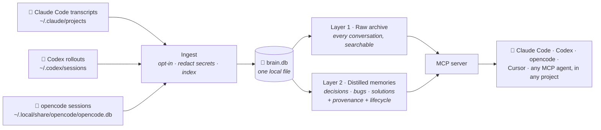

<div align="center">

# 🧠 Brain-RAG

### Persistent memory for AI coding agents

**Your AI assistant forgets everything the moment a session ends.<br/>
Brain-RAG makes sure it never has to rediscover your project again.**

[](https://www.npmjs.com/package/brain-rag)
[](#installation)
[](https://github.com/dasportillo/brain-rag/blob/main/LICENSE)
[](#-privacy)
[](#installation)

[Install](#installation) · [Quick start](#-quick-start) · [How it works](#%EF%B8%8F-architecture) · [Benchmarks](#-benchmarks) · [FAQ](#-faq)

</div>

---

<!-- TODO: docs/demo.gif — record with vhs/asciinema: ask "where did I leave off?" in a fresh session and watch the agent answer from memory -->

```text
$ claude    # fresh session, zero context given

> where did I leave off on the payments service?

⏺ brain · get_state(payments-service)
  You were mid-migration to the new ledger API. Decided on Tuesday to keep
  idempotency keys in Postgres (not Redis) — see the outbox pattern note.
  Two TODOs open: retry policy for webhooks, and the staging credentials
  rotation you postponed.

> why did we drop Redis for idempotency?

⏺ brain · search_context("idempotency keys Redis vs Postgres")
  Decision (3 weeks ago): Redis eviction under memory pressure could drop
  keys mid-flight → double-charges. Postgres keeps them transactional with
  the write itself. You benchmarked it: +4ms p99, considered acceptable.
```

**No re-explaining. No re-discovering. No "as I mentioned in another chat".**

---

## 💡 Why Brain-RAG exists

Every day, AI coding agents start from zero:

- 🔁 You re-explain the architecture you already explained last week
- 🐛 Your agent re-discovers the bug you fixed together a month ago
- ❓ Nobody remembers **why** a decision was made — only that the code looks like this
- 📉 The context you build in every session — hundreds of hours of it — **evaporates**

Here's the thing: **that context already exists.** Claude Code, Codex and opencode save every session on your machine. Hundreds of conversations documenting every decision, every fix, every dead end — sitting in a folder, unused.

Brain-RAG turns that archive into **long-term memory your agents actually use** — automatically, from any project, in any session, with any agent.

> **Brain-RAG is not another chatbot memory, not another vector database, not another RAG demo.**
> It's the memory layer your AI coding workflow is missing — built for real engineering work: decisions with their *why*, knowledge that gets outdated, projects that span months, and privacy that isn't negotiable.

## ✨ Features

| | |
|---|---|
| 🧠 **Remembers decisions — and the *why*** | Ask *"why did we drop Redis?"* and get the actual reasoning from the actual conversation, with dates and sources. |
| 📌 **Distilled memories, not just chat logs** | `/distill` turns a working session into typed knowledge: decisions, bug root causes, solutions, lessons. One claim per memory, the conclusion first, so a person opening it reads an answer and not a paragraph. Each memory keeps a link back to the exact conversation that produced it. |
| 🕰️ **Knows what's current vs outdated** | Knowledge changes. When newer information supersedes older, your agent sees it flagged — it won't resurrect a plan you reverted two weeks ago. |
| 📍 **"Where did I leave off?"** | A curated per-project state note — what's in flight, what's decided, what's blocked, what's next — ready the moment you ask. |
| 🔀 **One memory, all your agents** | Claude Code, Codex and opencode share the same brain out of the box. Any MCP-compatible agent (Cursor, Windsurf, VS Code) can connect. Your memory belongs to **you**, not to a vendor. |
| ⚡ **Instant recall** | Finds the right moment across tens of thousands of indexed conversation fragments in ~90 ms — including exact identifiers like error strings, function names, and ARNs. |
| 🔒 **Local by default** | Local embedding model, local database, zero external API calls. Your conversations never leave your machine — the one exception is the optional **Brain Teams** sync, which shares only distilled memories, never raw transcripts. |
| 🎛️ **Opt-in by default** | Nothing is saved unless you say so. One command opts a session in; everything else is forgotten. |

## 🎬 Real examples

Things you can ask in a **brand-new session**, in any project, that Brain-RAG answers from your history:

```text
"How did we solve the 502 on large document uploads?"
 → the fix, the root cause (payload limit mismatch between services), and the date

"What did we decide about tenant isolation in the shared database?"
 → row-level security via entity_id, plus the alternatives you rejected and why

"Have I dealt with this EventBridge → Lambda permission error before?"
 → yes: the exact recurring deploy failure and the ARN fix, from two months ago

"¿Qué reglas disparan la auditoría VCO?"  🇪🇸
 → works in Spanish and English, even mixed in the same history
```

## 📦 Installation

Requires **Node 22.5+**.

```bash
npx -y brain-rag install
```

That's it. The installer registers the memory server with **Claude Code**, **Codex** and **opencode** (each one if present), installs the `/brain`, `/state` and `/distill` commands in all of them, and prints the optional automation hooks. For opencode it adds a `brain` entry under `mcp` in your global config (`~/.config/opencode/opencode.jsonc`, or `opencode.json`), editing it in place so your comments survive and leaving a `.bak-brain-rag` copy next to it. It also installs a **plugin** and a short brain section in `~/.config/opencode/AGENTS.md` (only the block between brain-rag's markers is ever touched), so opencode needs no hook wiring at all — see [opencode runs on its own](#opencode-runs-on-its-own).

<details>
<summary><b>Upgrading — the slash commands keep themselves current</b></summary>

`/distill` is a **file** on disk (`~/.claude/commands/distill.md`, `~/.codex/prompts/distill.md`, `~/.config/opencode/commands/distill.md`), written at install time. The extraction rules inside it change between versions, so a file left from an older install would keep filling your brain in the old format long after you upgraded.

It repairs itself. Every generated file is stamped with a hash of what Brain-RAG wrote, and the things that already run on every session — the MCP server, the `mark-keep` SessionStart hook and the opencode plugin, all launched through `npx -y brain-rag` — rewrite any file the package has moved past (the opencode plugin itself included). Nothing to remember, and it works under `npx` (an npm `postinstall` would not: `npx` never runs one).

Two cases it deliberately will not handle silently:

- **You edited the file.** The stamp no longer matches, so it is yours: Brain-RAG leaves it alone and prints one line saying it may be missing newer rules. `npx -y brain-rag install` forces the update and keeps your version as `distill.md.bak`.
- **You use neither the MCP server nor the hook.** Then nothing of Brain-RAG runs on its own and nothing can refresh anything — re-run `npx -y brain-rag install` after upgrading.

A file written by a version older than this mechanism is replaced on first run, with the previous text kept as `.bak`.
</details>

<details>
<summary><b>Other MCP agents (Cursor, Windsurf, VS Code, …)</b></summary>

Brain-RAG speaks the open Model Context Protocol over stdio, so any MCP client can use the same memory. Point your agent at:

```json
{ "mcpServers": { "brain": { "command": "npx", "args": ["-y", "brain-rag", "serve"] } } }
```

or the equivalent in your client's MCP configuration. All tools (`get_context`, `search_context`, `explore_entity`, `get_state`, `save_state`, `save_memories`, `keep_session`, `list_projects`) work identically. Searching and saving works from any client; indexing that client's *own* conversations needs an adapter for its transcript format ([`docs/ADAPTERS.md`](https://github.com/dasportillo/brain-rag/blob/main/docs/ADAPTERS.md)).
</details>

<details>
<summary><b>Manual registration / from source</b></summary>

```bash
# just the memory server, no commands or hooks
claude mcp add brain --scope user -- npx -y brain-rag serve
codex mcp add brain -- npx -y brain-rag serve
# opencode: under "mcp" in ~/.config/opencode/opencode.jsonc
#   "brain": { "type": "local", "command": ["npx", "-y", "brain-rag", "serve"] }

# from source
git clone https://github.com/dasportillo/brain-rag.git && cd brain-rag && ./install.sh
```

To uninstall: `npx -y brain-rag uninstall` (add `--purge` to also delete the index and notes).
</details>

## 🚀 Quick start

**1 · Give your agent its memory back** — import the conversations you already have:

```bash
npx -y brain-rag import          # index your existing history (runs locally)
npx -y brain-rag import --dry    # preview first
```

> **Joining a team on Brain-RAG Teams?** Run `npx -y brain-rag onboard` instead. It lists the projects on your machine, lets you pick which ones to bring over (personal repos stay out), shows the token cost up front, then imports, distills and syncs their history to the team store in one guided run. `--dry` previews everything without spending a token.

**2 · Ask.** Open your agent in any project and ask *"where did I leave off?"*, *"what do we know about this repo?"*, *"how did I solve X?"*. The agent queries the brain on its own.

**3 · Keep it growing:**

| Command | What it does |
|---|---|
| `/brain` | Opt **this** session into memory (nothing is saved otherwise) |
| `/distill` | Extract this session's durable knowledge — decisions, fixes, lessons — into typed memories |
| `/state` | Update the curated "where I am today" note for the project |

<details>
<summary><b>Optional: automate it</b> — index on session end, opt in with a flag</summary>

Add to `~/.claude/settings.json` (the installer prints these ready to paste):

```jsonc
"SessionStart": [{ "matcher": "", "hooks": [{ "type": "command", "command": "npx -y brain-rag mark-keep", "timeout": 20 }] }],
"SessionEnd":   [{ "matcher": "", "hooks": [{ "type": "command", "command": "nohup npx -y brain-rag ingest >> \"$HOME/.claude/brain/ingest.log\" 2>&1 &", "timeout": 30 }] }]
```

Then `BRAIN=1 claude` (or a `claude --brain` shell alias) starts a session that remembers itself, and every opted-in session is re-indexed automatically when it ends. Codex sessions ride the same ingest: Codex has no session-end hook, so a session you mark with `/brain` there is indexed by the next ingest run (the Claude Code hook, or `npx -y brain-rag ingest`). opencode does its own — see below.

**Indexed means archived.** Claude Code deletes its own transcripts after `cleanupPeriodDays` (30 by default). Once a session is in the brain that no longer matters: its text lives in `brain.db`, and a session whose transcript is gone stays searchable — `ingest` reports it as *archived* and never deletes it on its own (remove sessions explicitly with `brain-rag forget`, or `ingest --prune`). Still, a session the agent deletes **before** the brain indexes it is gone for good, so raising `"cleanupPeriodDays"` in `~/.claude/settings.json` (e.g. `3650`) is a good idea.

**Auto-distill + team sync at session end** (optional, costs tokens): append a distill hook to the `SessionEnd` array — it turns each kept session into typed memories and, if you've run `brain-rag cloud login`, pushes them to your team in the same step:

```jsonc
{ "type": "command", "command": "nohup npx -y brain-rag distill --hook >> \"$HOME/.claude/brain/distill.log\" 2>&1 &", "timeout": 30 }
```

**Project context at session start** (optional, model-free and instant): append to the `SessionStart` array — it injects the project's `get_context` briefing when a session opens in a repo the brain knows, and prints nothing elsewhere:

```jsonc
{ "type": "command", "command": "npx -y brain-rag context --hook", "timeout": 10 }
```

**Capture-all (opt-out) mode:** prefer keeping everything by default? `brain-rag default on` keeps every session; exclude a repo with `brain-rag never add` inside it. Precedence: `BRAIN=1/0` > `never.list` > `always.list` > `default`.
</details>

### opencode runs on its own

`install` drops a plugin into `~/.config/opencode/plugins/brain-rag.js` that does for opencode what the hooks above do for Claude Code — nothing to paste anywhere. Restart opencode after installing so it loads the plugin.

> **Out of the box nothing is kept — the brain is opt-in.** Run `npx -y brain-rag default on` to keep every opencode session automatically (exclude a repo with `brain-rag never add` inside it), or opt single sessions in with `/brain`.

| opencode event | what brain-rag does |
|---|---|
| session created | applies the same keep policy (`BRAIN=1/0` > `never.list` > `always.list` > `brain-rag default`) |
| session goes idle | indexes it in the background (incremental, one ingest at a time) |
| session quiet for 10 minutes | distills its memories with **opencode's own model**, then auto-syncs to the team if you're connected — a session resumed and grown later is distilled again |

The plugin only spawns `brain-rag opencode …` in the background and swallows its own errors, so it can never slow opencode down or break it. It works on macOS, Linux and Windows (where it goes through `cmd.exe` with hidden windows; a run still in progress when you close opencode's terminal resumes on the next session). Logs go to `~/.claude/brain/opencode.log` — the first place to look if nothing is being kept. Distillation runs on whatever model your opencode uses by default (free and local models included) with every tool denied; turn it off with `npx -y brain-rag opencode distill off`, or tune `opencodeDistillQuietMinutes` / `opencodeDistillModel` in `~/.claude/brain/config.json`. Running brain-rag from a checkout? Start opencode with `BRAIN_RAG_BIN="node /path/to/brain-rag/cli.mjs"`.

## 🏗️ Architecture

Two layers, one principle: **raw history is never lost, distilled knowledge is never untraceable.**



- **Layer 1 — the archive.** Every opted-in conversation, chunked and indexed. Immutable, complete, the source of truth.
- **Layer 2 — the memory.** Typed, self-contained knowledge distilled from sessions (`decision`, `bug`, `solution`, `architecture`, …) with confidence, a temporal lifecycle (`active` → `superseded`), and links back to the exact source conversation. Nothing is generated without evidence.
- **Retrieval** fuses semantic search (paraphrases, cross-language) with exact-term search (error strings, identifiers) and recency — because *"the groups-claim bug"* and *"why is RBAC broken"* should both find the same fix.

<details>
<summary><b>Under the hood</b> — for the technically curious</summary>

- **Embeddings**: `Xenova/multilingual-e5-small` running locally via transformers.js — multilingual because real corpora mix languages. No API keys, works offline.
- **Store**: Node's built-in SQLite (`node:sqlite`) — one file, zero native compilation, versioned schema migrations.
- **Hybrid search**: brute-force cosine over cached candidate vectors + SQLite **FTS5/BM25** (diacritics-normalized), fused with Reciprocal Rank Fusion, recency as a gentle third signal. Measured: the lexical leg alone is worth ~10 points of Recall@8.
- **Temporal signal**: near-duplicate results from different dates get flagged (`⚠️ superseded` / `✅ latest of N`) so stale plans never masquerade as current ones. Curated state notes and Layer-2 statuses complement it.
- **Anti prompt-injection**: everything retrieved is wrapped as *historical evidence, not instructions* — old conversations can't steer the current session.
- **Cross-project hygiene**: results spanning projects are faceted (the same word can mean different things per project), and fragmented project names can be merged via `aliases.json`.

The full deep dive lives in [`docs/ARCHITECTURE.md`](https://github.com/dasportillo/brain-rag/blob/main/docs/ARCHITECTURE.md); every CLI command, MCP tool, flag and env var is in [`docs/REFERENCE.md`](https://github.com/dasportillo/brain-rag/blob/main/docs/REFERENCE.md).
</details>

## 📊 Benchmarks

Retrieval quality is **measured, not eyeballed** — a labeled eval of real known-item questions runs against the real corpus, and every retrieval change must beat the previous baseline to ship ([method & history](https://github.com/dasportillo/brain-rag/blob/main/docs/EVAL-BASELINE.md)).

Baseline of 2026-07-11 (v1.0.0): 123 real questions across 5 kinds (solution, exact-term, decision, state, entity), Spanish and English, over 560 sessions · 30,802 chunks.

| Metric | Default (hybrid) | `rerank: true` (opt-in) |
|---|---|---|
| Recall@1 | 0.59 | **0.76** |
| Recall@5 | 0.80 | **0.85** |
| Recall@8 | 0.85 | **0.86** |
| MRR | 0.676 | **0.798** |
| nDCG@8 | 0.718 | **0.814** |
| Search latency (p50 / p95) | **92 ms / 107 ms** | 1,060 ms / 1,241 ms |

Ablation on the same set: vector-only search scores Recall@8 **0.60** — the exact-term leg is worth ~25 points, which is precisely the class of query (*error strings, function names, resource ids*) that matters in engineering work. The corpus has grown since this baseline; re-measuring it is on the [roadmap](https://github.com/dasportillo/brain-rag/blob/main/docs/ROADMAP.md#next).

## 🔒 Privacy

Your conversations contain **API keys, internal architecture, unreleased plans**. Brain-RAG is built around that fact:

- ✅ **Local by default** — local embedding model, local database, zero external calls; works offline. The only data that ever leaves is the optional **Brain Teams** sync: distilled Layer-2 memories (never raw transcripts), and only after you `brain-rag cloud login`.
- ✅ **Secrets are scrubbed at ingest** — JWTs, AWS keys, GitHub/Slack tokens, private keys, `password=`-style values are redacted before anything is stored.
- ✅ **Opt-in by default** — no session is indexed unless you opt it in (`/brain`, `BRAIN=1`, or an explicit `import`). Prefer the inverse? `brain-rag default on` captures every session (opt-out), and `brain-rag never add` excludes a repo.
- ✅ **Right to forget** — `brain-rag forget <filter>` removes sessions from the index; `uninstall --purge` deletes everything.
- ✅ **Retrieved memory is evidence, not instructions** — wrapped so past content can never override your agent's current behavior.

## ❓ FAQ

<details>
<summary><b>Does this send my code or conversations anywhere?</b></summary>

No — the local brain sends nothing. The embedding model runs in-process, the database is a local file, and the server only talks to your agent over stdio: no telemetry, no cloud, no account. The one opt-in exception is **Brain Teams** (`brain-rag cloud login`), which syncs only distilled memories — never raw transcripts — to a team server you control.
</details>

<details>
<summary><b>Will it slow my agent down?</b></summary>

No — searches answer in ~90 ms at the median over a 30k-fragment corpus. The first run downloads the embedding model (~100 MB, one time).
</details>

<details>
<summary><b>How is this different from my agent's built-in memory?</b></summary>

Built-in memories are small, opaque, and locked to one vendor. Brain-RAG indexes your **entire working history**, keeps evidence for every memory (which conversation, which day, why), knows when knowledge is outdated, and serves **every agent you use** from the same store. The memory belongs to the developer, not the model.
</details>

<details>
<summary><b>What if an old conversation contains something wrong or reverted?</b></summary>

Three defenses: near-duplicate results from different dates are flagged (`superseded` / `latest of N`), Layer-2 memories carry an explicit lifecycle (`active`/`superseded`/`deprecated`), and the curated state note is the always-current answer to "what's true today". Retrieval prefers current knowledge; it never silently blends eras.
</details>

<details>
<summary><b>What exactly gets stored?</b></summary>

Only sessions you opt in. From those: user/assistant turns, session summaries, a compact trace of commands/files touched, and any distilled memories — all secret-redacted. You can inspect everything (`brain-rag search`, `brain-rag stats`) and delete anything (`forget`).
</details>

<details>
<summary><b>Does it work with languages other than English?</b></summary>

Yes — the embedding model is multilingual and the lexical index is diacritics-aware. The reference corpus is a real Spanish/English mix, and both languages score equally in the eval.
</details>

<details>
<summary><b>How much disk does it use?</b></summary>

Roughly 100–200 MB for the model (one-time) plus a database that grows with your opted-in history — ~2 MB per hundred conversation fragments. A year of heavy use fits comfortably under a gigabyte.
</details>

## 🗺️ Roadmap

Brain-RAG grew from *searchable history* into a **long-term memory system** — what shipped, the principles, and what's still open live in [`docs/ROADMAP.md`](https://github.com/dasportillo/brain-rag/blob/main/docs/ROADMAP.md):

- ✅ Hybrid retrieval (semantic + exact-term + recency), measured by a growing eval suite
- ✅ Layer 2: distilled, typed memories with provenance and temporal lifecycle
- ✅ Multi-agent: Claude Code + Codex + opencode sharing one brain
- ✅ Team ramp-up: `brain-rag onboard` turns a developer's existing history into team memory; `brain-rag consolidate` judges the near-duplicates bulk distillation leaves behind (merge / supersede / close resolved TODOs — nothing deleted)
- ✅ Memories written for a reader: one claim each, the conclusion first, a title that is a claim and not a summary — every new memory is distilled to that shape, by `/distill` and by the headless extractor alike
- ✅ Automatic distillation — the Claude Code `distill --hook` at session end, and the opencode plugin once a session goes quiet
- ✅ `get_context`: a ready-made project briefing (state + decisions + open TODOs + conflicts), also injectable at session start with `context --hook`
- ✅ Entity graph (services ↔ databases ↔ projects ↔ files) complementing search — `explore_entity`
- ✅ Local cross-encoder reranker, opt-in per query (`rerank: true`) — sharper for cross-language queries, off by default because it costs latency
- ✅ The index is the archive: sessions stay searchable after the agent deletes its transcript

## 🤝 Contributing

Contributions are welcome — and the bar is refreshingly objective: **retrieval changes must beat the eval baseline** ([`docs/EVAL-BASELINE.md`](https://github.com/dasportillo/brain-rag/blob/main/docs/EVAL-BASELINE.md)), everything else needs tests (`npm test`, no model download required).

Great places to start:

- 🧪 Grow the eval: memory-targeted cases, `get_context` faithfulness, more languages
- 🧹 The open list in the [roadmap](https://github.com/dasportillo/brain-rag/blob/main/docs/ROADMAP.md#next)

Ingest is scoped to Claude Code, Codex and opencode; transcript adapters for more agents are not planned for now (other MCP clients can still connect to the brain).

```bash
git clone https://github.com/dasportillo/brain-rag.git && cd brain-rag
npm install && npm test
```

---

<div align="center">

**Your AI already helped you solve it once.<br/>Brain-RAG makes sure you never pay for the same discovery twice.**

⭐ If that resonates, a star helps other developers find it.

MIT © [dasportillo](https://github.com/dasportillo)

</div>
